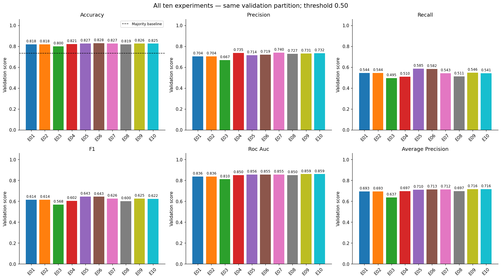

# School nonattendance in Nigeria using MICS 2021

This project compares ten classical and neural classification experiments using Nigeria MICS 2021. The task is to classify **reported attendance during the current school year** among children aged 5–17. It does not predict future dropout or establish causes of nonattendance.

**Mission:** Promote inclusive education by understanding patterns associated with nonattendance and informing where further investigation and educational support may be needed.

The supplied execution achieved **82.82% validation accuracy with E06**. E10 had the highest validation average precision (AP), **0.7163**. The exploratory 87% accuracy target was not met. **Final test evaluation was skipped**; these results must not be described as test accuracy.

## Project links

- GitHub repository: **[ADD YOUR REPOSITORY URL]**
- Dataset file already used: [Nigeria MICS survey ZIP on Google Drive](https://drive.google.com/file/d/1a1mH3YSxAxGWKWs9sHXtvieoS1yTBAaF/view?usp=drive_link). Access depends on the owner's sharing settings; public access has not been verified.
- Shared data and model **folder**: **[ADD GOOGLE DRIVE FOLDER URL]**. The dataset file link above is not a folder link and does not include the saved models.
- Presentation video: **[ADD VIDEO URL]**

## Repository contents

- `Nigeria_MICS_Final_Colab_TensorBoard.ipynb`: Colab notebook, separate E01–E10 functions, saved experiment outputs and an end-of-notebook TensorBoard dashboard.
- `requirements.txt`: pinned direct ML dependencies for the documented Colab rerun baseline.
- `results_snapshot/`: aggregate tables extracted from the supplied notebook, source fingerprint and TensorBoard run IDs. Displayed precision is retained; these are not the original full-precision runtime CSVs.
- `figures/`: actual PNG outputs extracted from the supplied execution, including learning curves, confusion matrix and ROC/precision–recall evidence.
- `REVIEW.md`: notebook review, setup edits and remaining evidence limits.
- `SUBMISSION_CHECKLIST.md`: remaining report, Drive and video steps.
- `.gitignore`: excludes raw data, trained models, event logs, evidence ZIPs and credentials.

The report is supplied separately as an editable Word document. Do not upload raw survey files or model/evidence archives to this repository.

## Data and outcome

Official source: [World Bank Microdata Library — Nigeria MICS 2021](https://microdata.worldbank.org/catalog/5959), produced by UNICEF; the survey was conducted by Nigeria's National Bureau of Statistics with UNICEF support. Obtain the data through the official access process and follow its terms. This repository does not grant data redistribution rights.

The notebook reads **only `fs.sav`**, directly or from the original nested survey ZIP. No joins are needed. The raw file contains **22,706 rows and 427 columns**, satisfying the assignment's minimum of 20,000 raw rows. After excluding 263 incomplete interviews and 11 unresolved targets, **22,432 records** remain: 16,428 attenders and 6,004 nonattenders.

Outcome: `0 = attended`, `1 = did not attend` school or an early-childhood programme during the current school year. Direct `CB7` responses define the label. For 4,435 records, explicit `CB4 = 2` (never attended) plus system-missing `CB7` reconstructs nonattendance. Missing `CB7` alone is insufficient.

The expected SHA-256 of the **uncompressed `fs.sav` bytes**, not the ZIP, is:

```text
6e5283706128255d4393db19ef397d41a9116d20ad94db1bc42351ca7f566ae4
```

Predictors are `CB3` (age), `HH52` (household children aged 5–17), `HL4` (sex), `HH6` (area), `HH7` (state/region), `MELEVEL` (mother's education) and `WINDEX5` (wealth quintile). The enhanced representation adds age bands and `log1p(HH52)`. Attendance answers, identifiers and survey weights are excluded from model inputs.

## Run in Google Colab

1. Open [Google Colab](https://colab.research.google.com/), choose **File → Upload notebook**, and upload the notebook from this repository. After publishing, you may also open it through Colab's GitHub tab using your repository URL.
2. Use a Python **CPU runtime**. The workflow has previously been checked with Python 3.12; the uploaded execution does not display its Python version. If the current Colab runtime cannot install these pins, choose a compatible runtime and record the change rather than silently switching versions.
3. Run **Install dependencies** once. It installs the same direct dependencies as `requirements.txt`. Restart the session once, then continue from **Load the input from Google Drive**. Do not rerun the install cell after training in the same session.
4. In that input cell, set `DRIVE_LINK` to the sharing link for your accessible survey ZIP or `fs.sav` **file**. You may use the project dataset link above if your account has access. Authenticate with that Google account when prompted. No public sharing is required for this import, and no API key should be pasted into the notebook.
5. Run the remaining cells in order. Check the source hash, raw shape and split counts before training. The initialization cell creates `TENSORBOARD_ROOT` before any experiment runs.
6. Run E01–E10. Each function creates a fresh model and a unique run directory, prints its own metrics and displays its own figures. Neural training uses `tf.data` and early stopping; it need not complete all 40 maximum epochs.
7. Review the combined comparison, model selection, learning diagnostics and subgroup errors. Keep `RUN_FINAL_TEST = False` when reproducing the reported execution.
8. Run **Package the evidence**. If you need to retain the trained files, set `DOWNLOAD_EVIDENCE = True` in **Optional backup download** before the Colab runtime ends. Downloading is not required to view figures, but `/content` is temporary.
9. Run the TensorBoard cell at the end to compare all completed runs in this session.

Use a fresh session for a complete rerun. `SESSION_ID` creates a new directory each time the input cell runs. Reexecuting the experiment-configuration cell resets its in-memory registry; rerun all experiments before comparing them. If preprocessing or partitions change, rerun every affected model.

### Environment evidence

The uploaded notebook prints NumPy 2.1.3, pandas 2.3.3, pyreadstat 1.3.6, scikit-learn 1.6.1, matplotlib 3.10.0 and joblib 1.6.0. Its install cell was rerun after training and requests pandas 2.2.3 and TensorFlow 2.21.0. Training-time TensorFlow, TensorBoard, Keras and Python versions are not visible in those saved outputs.

The GitHub copy therefore uses pandas 2.3.3 and a **documented rerun baseline of TensorFlow 2.20.0 / TensorBoard 2.20.0**, and prints loaded neural-library versions. These pins are not represented as the exact historical environment. Colab supplies IPython, `google.colab` and Google API/authentication libraries; this is a Colab workflow, not a standalone local installation recipe. Preserve the new `runtime_environment.json` and `environment_freeze.txt` when rerunning. Seeds and pins improve reproducibility but do not guarantee bit-identical results across runtimes or hardware.

## Split and preprocessing

All experiments use seed **42** and identical community partitions. `StratifiedGroupKFold` groups by `PSU`: a five-fold split reserves testing, then a four-fold split of the remainder reserves validation. No PSU appears in more than one partition.

- Training: **13,444 rows**, 1,046 PSUs, 3,536 nonattenders.
- Validation: **4,446 rows**, 351 PSUs, 1,183 nonattenders.
- Test: **4,542 rows**, 358 PSUs, 1,285 nonattenders.

These are approximately 60/20/20, not exact row percentages. Numeric imputation, missingness indicators, scaling and categorical imputation/one-hot encoding are fitted using training data. Full classical pipelines are refitted inside three grouped training CV folds. Neural matrices use the outer-training preprocessor. There are 54 baseline and 58 enhanced transformed features. Weights are used for descriptive checks only; reported model metrics are unweighted.

## Experiments and selection

- **E01:** logistic regression, baseline inputs, `C=1`.
- **E02:** logistic regression, `C={0.1,1,10}`, grouped-CV AP search.
- **E03:** baseline random forest, 150 trees, leaf size 1.
- **E04:** enhanced random forest, 150 trees, leaf sizes `{2,5}`, depths `{12,None}`, grouped-CV AP search.
- **E05:** baseline Keras MLP, hidden layers 64/32, Adam 0.001, batch size 128.
- **E06:** same network with enhanced inputs.
- **E07:** enhanced MLP, dropout 0.25, L2 0.0001, Adam 0.0003.
- **E08:** enhanced 200-tree forest, depth `{10,20,None}`, leaf `{2,8}`, max features `{'sqrt',0.8}`, grouped-CV accuracy search.
- **E09:** baseline histogram boosting, 200 iterations, rates `{0.05,0.1}`, leaves `{15,31}`, L2 `{1,10}`, grouped-CV accuracy search.
- **E10:** same boosting search with enhanced inputs.

The neural networks use sigmoid output, binary cross-entropy, at most 40 epochs and validation-loss early stopping with patience 5 and restored best weights. E05/E06 ran 10 epochs and restored epoch 5; E07 ran 38 and restored epoch 33 in the supplied execution.

All ten validation comparisons use threshold **0.50**. Final model selection uses the highest validation **AP within each family across all ten runs**: E10 (classical) and E06 (neural). Separate validation-F1 searches selected thresholds **0.35 and 0.38**, respectively. Scores at 0.50 must not be relabelled as scores at those tuned thresholds.



E06's 82.82% validation accuracy exceeds the 73.39% majority baseline but misses **495 of 1,183 nonattenders** at threshold 0.50. E05 leads recall at 0.50 (58.50%). E10 leads AP (0.7163) and ROC-AUC (0.8594). The CSV snapshot lists all ten results.

The test partition was inspected in earlier project work; this execution explicitly skips testing. Even a later evaluation on that partition must disclose its history. Do not describe the current scores as final test accuracy or the partition as untouched.

## TensorBoard and saved outputs

TensorBoard requires no W&B account, API key or cloud upload. The final notebook cell is:

```python
%load_ext tensorboard
%tensorboard --logdir {TENSORBOARD_ROOT}
```

Select runs under `E01` through `E10`. **Scalars/Time Series** shows validation metrics, classical accuracy versus training size and neural metrics versus epoch. **Images** shows confusion matrices and curves. **HParams** compares settings and validation metrics. Classical curves use training-example counts; neural curves use epochs. They do not share the same horizontal meaning.

Saved PNGs remain visible in the notebook without downloads. A static GitHub preview cannot run the interactive TensorBoard server. If no curves appear in Colab, confirm that training completed in the current session, refresh TensorBoard and select the correct session/run directories. An old dashboard may still point at an earlier `SESSION_ID`; restart it against the current `TENSORBOARD_ROOT`.

Under `/content/mics_project/<SESSION_ID>/`, the notebook creates:

```text
preprocessing_artifacts/       # dictionary, audit, split summaries and EDA
results/experiments.csv        # full runtime metrics/settings with run IDs
results/runs/E01/<run-id>/     # separate metrics, models and curves (also E02–E10)
results/locked_selection.json
results/runtime_environment.json
results/environment_freeze.txt
models/best_classical.joblib
models/best_neural.keras
models/best_neural.weights.h5
models/best_neural_preprocessor.joblib
models/model_manifest.json
tensorboard/                  # event files for all runs
experiment_evidence_tensorboard.zip
```

The ZIP contains the model/metrics/log evidence, not the raw dataset. `EXPORT_PRIVATE_ARRAYS = False` is the default and should remain so for this submission. The supplied notebook prints successful model saving and reload checks; the binaries and runtime archive were not attached for this review. To inspect TensorBoard after extracting your real evidence ZIP locally, install compatible TensorBoard and run `tensorboard --logdir tensorboard` from the extraction folder.

Classical models include their fitted preprocessing, but still require the notebook's cleaned and engineered input columns. Neural prediction additionally requires the matching saved preprocessor. Use `clean_feature` and `add_features`, the manifest and the same feature order; do not pass raw SPSS response codes straight into a neural network.

## Interpretation and limits

At its tuned threshold, E10 recalls about 74% of rural nonattenders and 42% of urban nonattenders. Recall is also much higher for reconstructed never-attended labels than direct-response nonattendance. These are validation descriptions, not adjusted causal findings or a completed fairness assessment. Maternal education, location and wealth have the largest E10 permutation effects, but feature importance does not establish causes.

Validation was reused for model selection, neural stopping and threshold tuning. One seed and one outer partition were studied. Classical curves at selected hyperparameters are diagnostics, not nested estimates of the entire selection process. The model is an educational research prototype and has not been validated for individual support-allocation decisions.

## Publish the repository

Create an empty GitHub repository, copy this folder's contents into your local project, and review the staged files before committing. The `.gitignore` prevents common data/model/log files from being added; it does not remove files that are already tracked. Keep `results_snapshot/` and `figures/`, which contain only curated aggregate evidence.

```bash
git init
git add README.md requirements.txt .gitignore REVIEW.md SUBMISSION_CHECKLIST.md Nigeria_MICS_Final_Colab_TensorBoard.ipynb results_snapshot figures
git diff --cached --stat
git status --short
git commit -m "Add Nigeria MICS classification project"
git branch -M main
git remote add origin YOUR_GITHUB_REPOSITORY_URL
git push -u origin main
```

These commands are for a new local repository. If your repository already exists, keep its existing remote and branch configuration. Replace the URL placeholder before pushing. The assignment's shared Drive folder should contain the raw ZIP and the selected model artifacts, with access verified separately. See `SUBMISSION_CHECKLIST.md` before submission.

## References

- [Nigeria MICS 2021 official catalog](https://microdata.worldbank.org/catalog/5959)
- [NBS and UNICEF 2021 MICS report](https://www.unicef.org/nigeria/reports/2021-multiple-indicator-cluster-survey-national-immunization-coverage-survey-report)
- [TensorBoard with Keras](https://www.tensorflow.org/tensorboard/scalars_and_keras)
- [Grouped stratified cross-validation](https://scikit-learn.org/stable/modules/generated/sklearn.model_selection.StratifiedGroupKFold.html)

The report provides the full scholarly references in IEEE style. No software or data licence is asserted by this package; respect the original dataset's access and use conditions.
